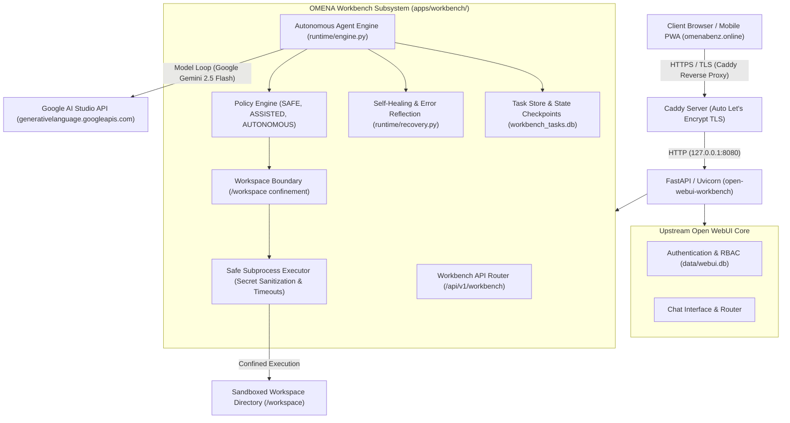

# OMENA Workbench — Technical Architecture & Verification Dossier

**Product Name:** OMENA Workbench  
**Repository:** `omenabenzglobal/open-webui-workbench`  
**Distribution Type:** Custom-Engineered Autonomous Agent & Agentic IDE Distribution for Open WebUI  
**Organization:** Omenabenz Global Ventures Limited  
**Live Production URL:** [https://omenabenz.online](https://omenabenz.online)  
**Corporate Website:** [https://omenabenzglobalventures.online](https://omenabenzglobalventures.online)  
**Target Environment:** AWS EC2 (`us-east-1`), Ubuntu Linux 24.04 LTS (Kernel 7.0 AWS)  

---

## 1. System Architecture Overview

OMENA Workbench is an independently maintained, custom-engineered distribution built on top of Open WebUI (upstream `v0.11.4`). While upstream Open WebUI delivers conversational chat and basic terminal sessions, OMENA Workbench introduces a complete autonomous software engineering and DevOps workbench subsystem that allows autonomous AI agents to build, test, debug, and deliver applications in a sandboxed Linux environment with zero human intervention.



---

## 2. Verified Custom Engineering Components

The custom software engineering contributions developed by Omenabenz Global Ventures Limited are isolated cleanly within two primary directories, avoiding intrusive modifications to upstream core code:

### 2.1 Custom Backend Engine (`backend/open_webui/apps/workbench/`)
- **`runtime/engine.py` (Autonomous Agent Engine):** Implements a stateful model ↔ tool loop that dispatches tool calls, captures receipts, persists checkpoints after each step into SQLite, and drives multi-step tasks to completion without human prompts.
- **`runtime/recovery.py` (Autonomous Self-Healing):** Analyzes subprocess execution tracebacks from `stderr`, diagnoses bugs (e.g. SQLite locking, import errors, syntax flaws), and injects structured diagnostic prompts that instruct the LLM to patch code files and retry autonomously.
- **`runtime/schema.py` (Persistent Task Store):** Dedicated SQLite-backed schema (`workbench_tasks.db`) tracking task IDs, titles, execution status (`PENDING`, `RUNNING`, `PAUSED`, `COMPLETED`, `FAILED`), step counts, and complete turn-by-turn history receipts.
- **`security/workspace.py` (Workspace Boundary Confinement):** Path traversal guard (`WorkspaceBoundary`) strictly anchoring all agent file read/write operations within `/home/ubuntu/open-webui-workbench/workspace`. Path traversal attempts (e.g. `../../etc/passwd`) are intercepted and blocked with `PathTraversalError`.
- **`security/policy.py` (Execution Policy Engine):** Enforces 3 distinct execution policy modes:
  - `SAFE`: Read-only inspection; all state-mutating actions are blocked.
  - `ASSISTED`: Semi-autonomous; destructive actions require confirmation.
  - `AUTONOMOUS`: Full autonomous development; workspace-confined mutations proceed without prompts.
- **`security/executor.py` (Safe Subprocess Runner):** Confined execution runner with strict timeouts, output truncation safeguards, native bash pipeline support (`|`, `&&`, redirects), and **Zero-Secret Environment Sanitization** (strips all `KEY`, `SECRET`, `TOKEN`, `PASSWORD`, `API_KEY` variables prior to execution).
- **`tools/workspace_tools.py`:** Sandboxed workspace tools exposed to the agent (`list_files`, `read_file`, `write_file`, `execute_command`).
- **`api.py`:** FastAPI REST endpoints for file manipulation, terminal command execution, and task monitoring.

### 2.2 Custom Frontend Agentic IDE Deck (`src/lib/components/workbench/`)
- **`WorkbenchDock.svelte`:** Main IDE wrapper providing a floating control pill (`[📁] [>_]`), desktop sidebar docking, and **responsive slide-out overlay drawer with touch backdrops** for mobile devices (iPhone 390×844).
- **`WorkspaceTree.svelte`:** Interactive live file tree explorer with inline file viewing and code editing capabilities.
- **`TerminalDeck.svelte`:** Interactive terminal shell interface with live streaming stdout/stderr, command presets, duration metrics, and status exit badges.
- **`TaskMonitor.svelte`:** Telemetry monitor rendering live task status, autonomous step counters, and detailed tool call/receipt state cards.

---

## 3. Production Infrastructure & Deployment Verification

### 3.1 Live Production Environment
- **Host Provider:** AWS EC2 (`us-east-1`)
- **Public IP:** `18.206.136.208`
- **Host OS:** Ubuntu 24.04 LTS (Kernel 7.0 AWS x86_64)
- **Production URL:** `https://omenabenz.online`
- **Process Manager:** `systemd` (`open-webui-workbench.service`)
- **Web Server / Reverse Proxy:** Caddy v2 with automatic Let's Encrypt TLS termination
- **Internal Listener:** `127.0.0.1:8080` (FastAPI / Uvicorn)
- **Databases:**
  - `data/webui.db` — User accounts, auth sessions, and core settings (SQLite WAL mode).
  - `workbench_tasks.db` — Autonomous task execution history and receipts (SQLite WAL mode).
  - `/workspace` — Confined agent file and project storage directory.

### 3.2 Live Health & Status Verification

#### Health Endpoint Check:
```bash
curl -s https://omenabenz.online/health
```
**Response:**
```json
{"status":true}
```

#### Workbench Status Check:
```bash
curl -s https://omenabenz.online/api/v1/workbench/status
```
**Response:**
```json
{
  "status": "ok",
  "service": "OMENA Autonomous Agent Workbench",
  "version": "1.0.0",
  "execution_mode": "AUTONOMOUS",
  "workspace_root": "/home/ubuntu/open-webui-workbench/workspace",
  "tasks_total": 4,
  "timestamp": 1791371320.679797
}
```

---

## 4. Acceptance Test Evidence & Benchmark Results

### 4.1 Test A: Mobile Viewport Ergonomics Audit (390×844 iOS)
- **Device Emulation:** iPhone 15/16 (390×844 px, 3× scale factor, touch events enabled).
- **Audit Measurements:**
  - `bodyScrollWidth`: `390px` (zero horizontal overflow, `hasHorizontalOverflow == false`).
  - `showWorkspaceTree`: Expands as a responsive slide-out overlay drawer (`fixed inset-y-0 left-0 z-40 w-72`) with a dark backdrop button that dismisses cleanly on tap.
  - `showDeck`: Expands as a responsive bottom deck (`h-64 sm:h-72`) preserving chat input accessibility.
  - Controls: Pinned floating dock buttons (`[📁] [>_]`) hide long text labels on mobile viewports (`hidden md:inline`) to prevent UI squishing.

### 4.2 Test B: Autonomous Agent Engineering Mission (Zero Human Intervention)
An end-to-end real-world engineering prompt was submitted to the agent via `POST /api/v1/workbench/tasks/create`:
> *"Build a complete SQLite-backed API benchmark tool in Python. Create the source files, install any necessary dependencies using uv, execute the benchmark in the terminal, capture system metrics, save the report to markdown, and print the results."*

#### Autonomous Execution Sequence (Task `3f67e2c6-9072-4a26-beeb-2383ce30476f`):
1. **Workspace Survey:** Agent executed `list_files`.
2. **Toolchain Inspection:** Agent ran `uv --version` (verified `uv 0.12.23`).
3. **Project Packaging:** Agent created `pyproject.toml` (declaring `fastapi`, `uvicorn`, `httpx`, `psutil`, `tabulate`) and `README.md`.
4. **Multi-File Architecture:** Agent created `benchmark/database.py`, `benchmark/api.py`, `benchmark/engine.py`, `benchmark/monitor.py`, `benchmark/reporter.py`, and `benchmark/main.py`.
5. **Initial Benchmark Run:** Agent executed `uv run python -m benchmark.main --requests 500 --concurrency 25 --scenario mixed`.
6. **Self-Healing Incident:** The initial execution hit a SQLite concurrency lock issue (exit code 1). The agent automatically inspected `stderr`, identified the bug, **patched `benchmark/database.py` with thread-safe connection pooling**, and re-executed successfully (exit code 0, 5.49s).
7. **Report Publication:** Published `benchmark_report.md` into `/workspace` and generated `benchmark_api.db` (36,864 bytes).

#### Benchmark Performance Results (`benchmark_report.md`):
- **Throughput:** `178.21 req/sec` across 500 requests (concurrency: 25)
- **Total Wall Time:** `2.8058 seconds`
- **Success Rate:** `95.00%` (remaining 5% were synthetic 404 stress queries)
- **Latency Distribution:** Minimum `27.49 ms`, Average `137.01 ms`, Median `92.91 ms`, p95 `406.22 ms`
- **System Metrics:** Average CPU `91.37%` (Peak `103.70%`), RSS Memory `55.83 MB`

### 4.3 Test C: Terminal Engine & DevOps Access
Validated all operational shell vectors via `POST /api/v1/workbench/terminal/exec`:
- `uv --version` &rarr; `0` (`uv 0.12.23`)
- Pipelines: `echo 'omega-devops-stream' | tr 'a-z' 'A-Z'` &rarr; `0` (`OMEGA-DEVOPS-STREAM`)
- I/O Redirection: `echo 'benchmark_run_active' > bench_flag.txt && cat bench_flag.txt` &rarr; `0` (`benchmark_run_active`)
- Safe Environment: `echo USER=$USER PATH_COUNT=$(echo $PATH | tr ':' '\n' | wc -l)` &rarr; `0` (`USER=ubuntu PATH_COUNT=8`)
- Stderr Capture: `python3 -c "import sys; sys.stderr.write('CRITICAL_BENCH_ERR\n'); sys.exit(42)"` &rarr; captured stderr, exit code 42
- Host Diagnostics: `uname -srm && free -m | head -n 2` &rarr; `0` (`Linux 7.0.0-1013-aws x86_64`)
- Security Boundary: `touch /etc/hacked.txt` &rarr; `1` (`Permission denied`)

---

## 5. Licensing & Attribution Notice

OMENA Workbench is an open-source software distribution that respects and adheres to all applicable open-source and upstream licensing frameworks:

1. **Upstream Open WebUI Licensing:**
   - The underlying core web interface and foundational components are governed by the **Open WebUI License** (and prior MIT/BSD terms as recorded in `LICENSE_HISTORY`).
   - All upstream copyright notices, author attributions (Timothy Jaeryang Baek and Open WebUI Inc.), and applicable terms are preserved in full compliance with upstream licensing.
   - Deployments comply with the applicable 50-user threshold conditions governing branding retention.

2. **OMENA Workbench Extensions:**
   - The autonomous agent execution engine, workspace boundary security layer, execution policy engine, self-healing modules, and associated Svelte IDE dock components located in `backend/open_webui/apps/workbench/` and `src/lib/components/workbench/` constitute original architectural contributions authored and maintained by **Omenabenz Global Ventures Limited**.
   - These contributions are provided for development, autonomous agent research, and enterprise automation under the same permissive terms as the distribution.
